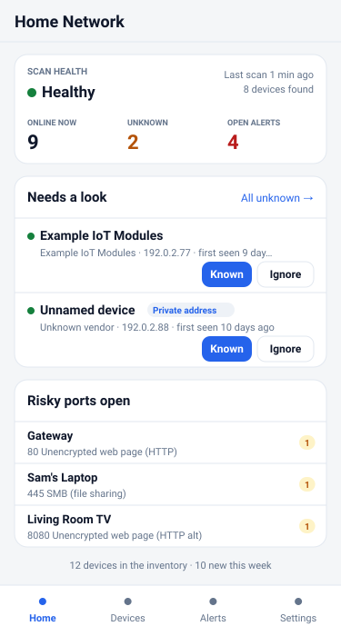
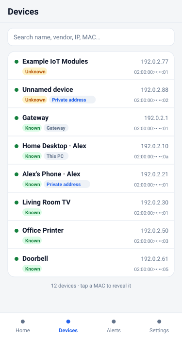
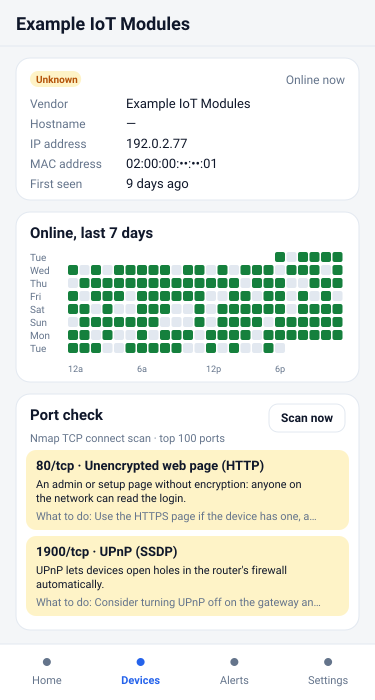
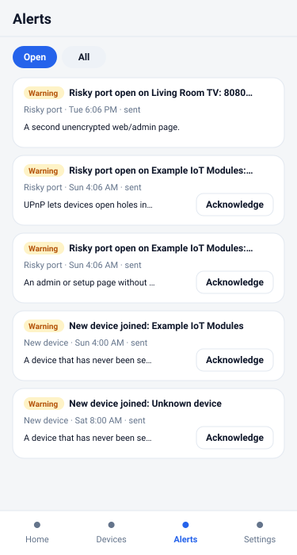
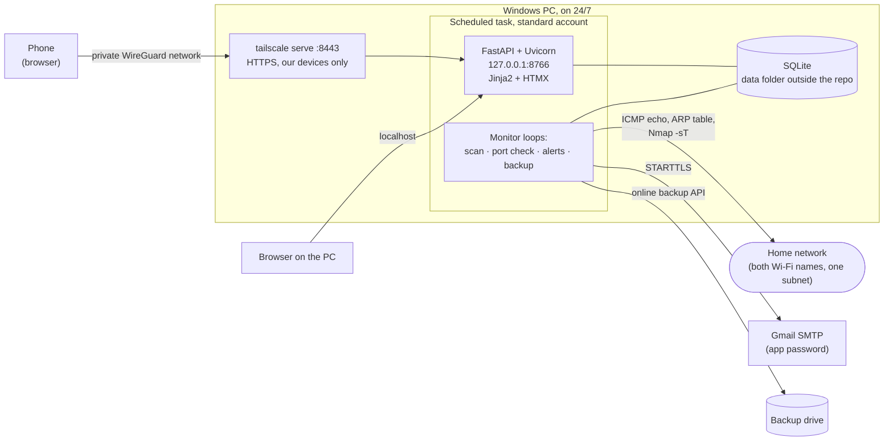

# Home Network Watcher

[](https://github.com/Mythiicmaan/home-network-watcher/actions/workflows/ci.yml)

A small, self-hosted monitor for one home network. It runs 24/7 on a Windows desktop, keeps an
inventory of every device on the network, and emails my phone when something new joins, when a
device has a risky port open, or when the network shows signs of ARP spoofing.

It needs no admin rights, no packet-capture driver, and no cloud service. It listens only on
`127.0.0.1` and is reached from phones over a private [Tailscale](https://tailscale.com) network.

> Everything in this repository, including the screens below, uses a **fake sample network**:
> `192.0.2.0/24` (an address range reserved for documentation) and MACs `02:00:00:xx:xx:xx`.
> Real data lives outside the repo and never enters it.
> See [Keeping real data out of a public repo](#keeping-real-data-out-of-a-public-repo).

<p>
  
  
  
  
</p>

## Features

- **Inventory:** every device's MAC, IP, hostname, vendor, first and last seen, plus a name, owner,
  and status (Known, Unknown, or Ignored). It works out which device is the PC it runs on.
- **Discovery every 5 minutes** as a standard Windows user: a ping sweep plus the Windows neighbor
  (ARP) table. Devices that ignore pings, like many phones, still show up.
- **New-device alerts:** the first scan is a silent baseline. After that, every never-seen MAC
  raises exactly one alert, and marking a device Known or Ignored quiets it for good.
- **Port checks:** each new device gets an Nmap TCP connect scan of the top 100 ports, and every
  risky port comes with a plain-English explanation and what to do about it.
- **Spoofing signs:** an alert if the gateway's IP starts answering from a different MAC, or if two
  devices keep trading the same IP.
- **Email alerts** through Gmail: each event is sent once, failures are retried with backoff and
  shown in a banner, several waiting alerts arrive as one summary, and a weekly digest goes out on
  Sunday evening.
- **Presence timeline:** a 7-day, hour-by-hour view of when each device was online.
- **Trustworthy scans:** a scan that looks broken (for example, because a VPN is connected) is marked
  *degraded* and never marks devices offline or sends alerts.
- **Backups:** nightly and integrity-checked, with a loud banner and an email if they ever fail.

## Architecture



| Layer | Choice | Why |
|---|---|---|
| Web | FastAPI, Uvicorn | Small, typed, and easy to test |
| UI | Jinja2, HTMX, a little vanilla JS | Server-rendered and phone-friendly, with no front-end build |
| Data | SQLite, SQLAlchemy 2.x, Alembic | One file that's easy to back up, and the schema can evolve |
| Discovery | Win32 `IcmpSendEcho`, `Get-NetNeighbor`, Nmap `-sT` | All work without admin rights or a capture driver |
| Quality | pytest, Ruff, GitHub Actions | 169 tests. Parsing and detection rules were tested before the UI existed |

```text
netwatch/
  discovery/        Adapter choice, ping sweep, neighbor table, names, vendor lookup
  detect.py         Pure detection rules: scan health, gateway MAC, IP conflicts, quiet hours
  ports.py          Nmap command, XML parsing, risky-port explanations, built-in fallback
  services/         Applying scans, port-check queue, reports, device edits
  monitor.py        The always-on loops (scan, port check, alert delivery, backup)
  alerts/           Email sender, rendering, delivery with retries and summaries
  backup.py         Backups, retention, and restore
  auth.py           PIN, signed cookies, rate limit, request guards
  web/, templates/  Routes and pages
scripts/            Install, restart, restore, check, screens, and the privacy check
tests/              pytest suite (sample data only)
```

## How discovery works (no admin rights)

1. **Pick the home adapter.** It chooses the physical adapter that has an IPv4 default gateway and a
   private address, and ignores VPN, Tailscale, and virtual adapters (VirtualBox, Hyper-V, and so on).
   Only private ranges are ever scanned, a `/22` at most; anything else is refused before a packet is sent.
2. **Ping sweep.** Each address in the subnet gets an ICMP echo via the Win32 `IcmpSendEcho` API
   (through `ctypes`), 64 at a time. Unlike raw sockets, this doesn't need admin rights.
3. **Read the neighbor table.** After a short pause, `Get-NetNeighbor` (or `arp -a`) lists the MAC
   for every address Windows just looked up.
4. **Decide who's present.** A device counts as seen if it answered the ping, *or* Windows just
   confirmed its MAC (neighbor state `Reachable`, `Delay`, or `Probe`). Phones that ignore pings still
   answer ARP, so they still show up; stale `Stale` entries don't count.
5. **Enrich.** Hostnames come from unicast mDNS, NetBIOS node status, or reverse DNS. Vendors come
   from the public IEEE/Wireshark OUI list, downloaded at runtime. Locally administered MACs are
   flagged as private (randomized) addresses, which phones use.
6. **Check the scan itself.** If the gateway didn't answer, or it found fewer than 30% of the usual
   devices, the scan is *degraded*. It updates last-seen for known devices but adds nothing, marks
   nothing offline, and sends no alerts. The warning names the VPN if one is connected.

A device is shown as online if it was seen in either of the last two good scans.

## Detection rules

Every rule is a pure function in `netwatch/detect.py` or `netwatch/ports.py`, and each one is
proven with **simulated** scan data in the tests. Nothing in this project sends spoofed or malicious
traffic.

| Alert | Rule | Why it matters | MITRE ATT&CK |
|---|---|---|---|
| New device | A MAC never seen before appears in a good (not degraded) scan after the baseline | An unknown device on the home network, whether a guest, a new gadget, or something planted | [T1200](https://attack.mitre.org/techniques/T1200/) Hardware Additions |
| Gateway MAC changed (**high priority**) | The gateway's IP answers from a different MAC than the trusted one. The alert also lists any other IPs that MAC answers for | The classic sign of ARP spoofing: another device posing as the router to intercept traffic | [T1557.002](https://attack.mitre.org/techniques/T1557/002/) ARP Cache Poisoning |
| IP conflict | One IP's MAC flip-flops A → B → A within 4 good scans. A one-way change is ordinary DHCP reuse and is ignored | Usually a static IP overlapping DHCP, but it can also mean ARP spoofing | [T1557.002](https://attack.mitre.org/techniques/T1557/002/) ARP Cache Poisoning |
| Risky port: Telnet 23, FTP 21, HTTP 80/8080 | Open on the device's latest port check | Logins cross the network in cleartext | [T1040](https://attack.mitre.org/techniques/T1040/) Network Sniffing |
| Risky port: RDP 3389, VNC 5900, SMB 445/139 | Same | Remote control and file sharing are common targets for lateral movement and worms | [T1021.001](https://attack.mitre.org/techniques/T1021/001/), [.005](https://attack.mitre.org/techniques/T1021/005/), [.002](https://attack.mitre.org/techniques/T1021/002/) Remote Services |
| Risky port: UPnP 1900/5000 | Same | Lets devices open holes in the router's firewall on their own | Hardening (no direct technique) |
| Unknown device keeps coming back | An Unknown device seen on several different days gets a "Back N days" badge | Something that keeps returning deserves a name | [T1200](https://attack.mitre.org/techniques/T1200/) Hardware Additions |

Every alert has a unique event key, so it is created **once**, however many scans see it. The PC
running NetWatch is recognized from its own adapter, and its port check never raises alerts: it's
checking itself, and Windows Firewall doesn't filter a PC talking to itself.

## Getting started

Requires Python 3.12. Discovery and the 24/7 scripts are Windows-only; the tests and the demo run
anywhere.

```powershell
py -3.12 -m venv .venv
.\.venv\Scripts\python -m pip install -e ".[dev]"
.\.venv\Scripts\pre-commit install

.\.venv\Scripts\python -m netwatch --sample --port 8768   # demo on the fake network, http://localhost:8768
```

For real use, copy `config.example.toml` to `config.toml` in your data folder
(`%NETWATCH_DATA_DIR%`, default `C:\NetWatchData`) and edit it. Install
[Nmap](https://nmap.org) for port checks; without it, a built-in TCP connect check covers the
risky ports.

```powershell
.\.venv\Scripts\python -m netwatch            # app + monitor on http://localhost:8766
.\.venv\Scripts\python -m netwatch scan       # one discovery pass, prints counts only
.\.venv\Scripts\python -m netwatch test-alert # send a test email
.\.venv\Scripts\python -m netwatch backup     # back up now
.\.venv\Scripts\python -m pytest
.\.venv\Scripts\ruff check . ; .\.venv\Scripts\ruff format --check .
.\.venv\Scripts\python scripts\make_readme_screens.py   # redraw the screens in this README
```

## Running 24/7 on Windows

From an **admin** PowerShell window, once:

```powershell
powershell -ExecutionPolicy Bypass -File .\scripts\install.ps1
```

It sets up:

- a standard, non-admin local account (`netwatchsvc`) that runs the app, with Modify rights only on
  the data and backup folders and Read on the code;
- a scheduled task that starts the app at boot, before anyone signs in, and restarts it on failure;
- a first backup, plus a check that the first scan works as the service account;
- phone access: `tailscale serve --bg --https=8443 http://127.0.0.1:8766`. Anything already served
  on 443 is recorded before and checked after, so another app's setup is never disturbed.

```powershell
powershell -ExecutionPolicy Bypass -File .\scripts\check_service.ps1  # running? scans, backups OK?
powershell -ExecutionPolicy Bypass -File .\scripts\restart.ps1        # pick up new code
powershell -ExecutionPolicy Bypass -File .\scripts\restore.ps1 <backup .db file>
powershell -ExecutionPolicy Bypass -File .\scripts\uninstall.ps1      # undo (data untouched)
```

**Backups** run nightly at 2:30 AM to `[backup] dir`, using SQLite's online backup API. Each copy
is integrity-checked, and 30 daily and 12 monthly copies are kept. If the drive is missing, nothing
is written anywhere else: a banner appears, `/health` reports it, one email goes out per day, and it
retries hourly.

## Security design

| Layer | What it does |
|---|---|
| Network | Uvicorn binds to `127.0.0.1` only. There is no port forwarding, LAN listener, or firewall rule. Phones reach it through `tailscale serve`, on our own devices only |
| Least privilege | The app runs as a standard local account, with access only to the folders it needs. Discovery and port checks never need admin |
| Scan scope | Only the auto-detected private subnet is scanned (a `/22` at most). Public ranges are refused in code, and Nmap is limited to TCP connect scans |
| Sign-in | A shared PIN hashed with Argon2, an HMAC-signed `HttpOnly`, `SameSite=Lax` cookie, and rate-limited attempts. The PIN can only be changed from the PC itself |
| Desktop convenience | The PIN is skipped only for a direct localhost request. Anything carrying proxy or Tailscale headers is treated as remote, so a phone can never pass as the desktop |
| Request guards | A Host allow-list blocks DNS rebinding, same-origin checks block cross-site form posts, and a strict Content Security Policy limits scripts to the app itself |
| Privacy in the UI | MACs are masked until tapped, and `/api/summary` returns counts only, never MACs or IPs |
| Secrets | The Gmail app password lives in `config.toml` outside the repo, and never appears in pages, logs, or errors. The PC's name is kept out of email headers |
| Backups | SQLite's online backup API, integrity-checked, written to a separate drive. A missing drive fails loudly and never writes somewhere else |

## Keeping real data out of a public repo

A network monitor's database is a map of a household: every device, who owns it, and when it's
home. Several independent layers would all have to fail before any of that leaked:

1. **Separation:** real data lives in a folder outside the repo, so git can't see it.
2. **`.gitignore`** blocks databases, `config.toml`, logs, CSVs, `.env`, and the vendor-list cache.
3. **Sample data only:** tests, CI, and these screens use the documentation range `192.0.2.0/24` and
   locally administered `02:00:00` MACs.
4. **Pre-commit hooks:** `gitleaks` scans for secrets, and `scripts/check_private_data.py` checks every
   commit, including its message, against private deny lists kept outside the repo. It also blocks
   any real-looking MAC; private, Tailscale, and public IPv4 and IPv6 addresses; `*.ts.net` and ISP
   host names; spreadsheets; and binary files. That's why the screens above are text-based SVGs.
   Test values that must be blocked are built at runtime, so the checker never flags itself.
5. **CI runs the same checks** on every tracked file.
6. **Private first:** the repo stayed private until its full history had been audited.

## What I learned

- **"No admin" changes how you see a network.** Raw sockets and packet capture were off the table, so
  discovery became a ping sweep through a Win32 API plus a read of the Windows ARP table. It turned out
  that devices which ignore pings still have to answer ARP, and that was the key to finding phones.
- **A broken scan must not look like an empty house.** With a VPN connected, a scan sees almost
  nothing. Treating that as "everyone left" would mark every device offline and then alert on all of
  them coming back. Checking the gateway and the usual device count first keeps bad scans quiet.
- **A scanner checking itself sees the wrong picture.** The PC's own port check showed SMB open, but
  Windows Firewall doesn't apply to a PC talking to itself, so that result said nothing about what
  other devices could reach. The app now recognizes its own adapter and treats those results as
  information, not alerts.
- **Private MAC addresses split one phone into many.** Phones use a different address on each Wi-Fi
  name, so one phone can appear as several devices. Timing can suggest which entries belong together,
  but my best guess based on timing turned out to be wrong. The phone's own Wi-Fi settings are the proof.
- **A schema migration deleted data, and the database file saved it.** SQLite rebuilds a table to
  alter it, and with foreign keys on, dropping the old table cascade-deleted every linked row. The
  pre-migration state was still in the main database file because the write-ahead log hadn't been
  checkpointed, so I copied it before anything else touched the database, restored the rows, and fixed
  migrations to run with foreign keys off. A regression test now upgrades a database that has linked
  rows.
- **"Always on" means nothing can close it by accident.** Running the app in a terminal tab worked
  until the tab closed, and then two days went unmonitored without anything saying so. A scheduled
  task under its own account, a `/health` endpoint, and a check script fixed that.
- **A backup isn't real until you've restored it.** The first backup was test-restored before
  this phase was called done.

## License

[MIT](LICENSE)
